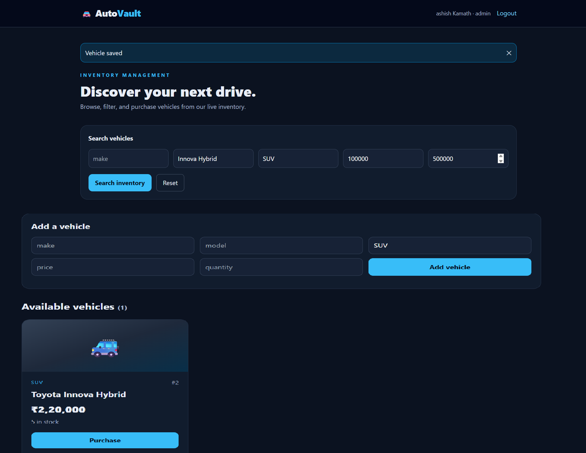
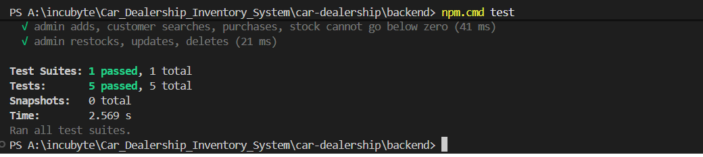

# AutoVault — Car Dealership Inventory System

Full-stack React + Tailwind + Express + SQLite inventory application with JWT authentication and customer/admin roles.

## Prerequisites
- Node.js 20+ and npm
- Recommended: VS Code, Git

## Backend
```bash
cd backend
npm install
cp .env.example .env
npm test
npm start
```
On Windows PowerShell, use `Copy-Item .env.example .env` instead of `cp`.
API listens on `http://localhost:4000`.

## Frontend (new terminal)
```bash
cd frontend
npm install
npm run dev
```
Open the Vite URL displayed in the terminal (usually `http://localhost:5173`). To change the API URL, create `frontend/.env` with `VITE_API_URL=http://localhost:4000`.

## First admin account
All public registrations are customers. To promote your own newly registered account to admin, stop the backend, back up `backend/dealership.db`, and use a SQLite GUI or CLI:
```sql
UPDATE users SET role='admin' WHERE email='your-registered-email@example.com';
```
Restart the backend and log in again. Never expose admin assignment via public registration. This step is intended for local development; use a secure admin provisioning procedure in production.

## Endpoints
- POST `/api/auth/register`, POST `/api/auth/login`
- GET `/api/vehicles`, GET `/api/vehicles/search?make=&model=&category=&minPrice=&maxPrice=`
- POST `/api/vehicles` (admin), PUT `/api/vehicles/:id` (admin), DELETE `/api/vehicles/:id` (admin)
- POST `/api/vehicles/:id/purchase`, POST `/api/vehicles/:id/restock` (admin)
All vehicle endpoints require `Authorization: Bearer <token>`.

Example create body: `{"make":"Toyota","model":"Camry","category":"Sedan","price":2000000,"quantity":5}`.
Restock body: `{"quantity":3}`. Purchase decreases quantity atomically and rejects out-of-stock purchases.

## Tests and TDD
`cd backend && npm test` runs Jest/Supertest API tests. Tests cover authentication, admin authorization, creation, search, purchase/stock floor, restock, update, and deletion.

**Important:** This starter ZIP does not manufacture a Red-Green-Refactor Git history. To satisfy the assignment, build additional changes test-first and commit the failing test, passing implementation, and refactor separately. Add actual test results and screenshots to this README after running it.

## My AI Usage
ChatGPT was used to draft the initial project scaffold, backend routes, React interface, and example API tests. Review, run, verify, and adapt all generated code yourself. Record any additional AI usage, actual prompts, corrections, and your personal reflection here. In AI-assisted commits, add the co-author trailer required by your assignment, using a truthful tool identity.

## Submission checklist
- [ ] Run backend and frontend locally
- [ ] Run tests and record real output
- [ ] Perform and document genuine TDD iterations in Git
- [ ] Take screenshots of your working application
- [ ] Add full, raw AI chat logs or public links to `PROMPTS.md`
- [ ] Expand My AI Usage with your own reflection
- [ ] Push your own work to a public GitHub/GitLab repository
- [ ] Optional: deploy and add live URL

## Production notes
Set a strong JWT secret; configure CORS allowlist, HTTPS, rate limiting, stronger input validation and transactions/audit records for purchase workflows before production deployment. This is an educational project starter, not a payment-processing application.
## Application Screenshots

### Admin Dashboard


### Backend Test Results
